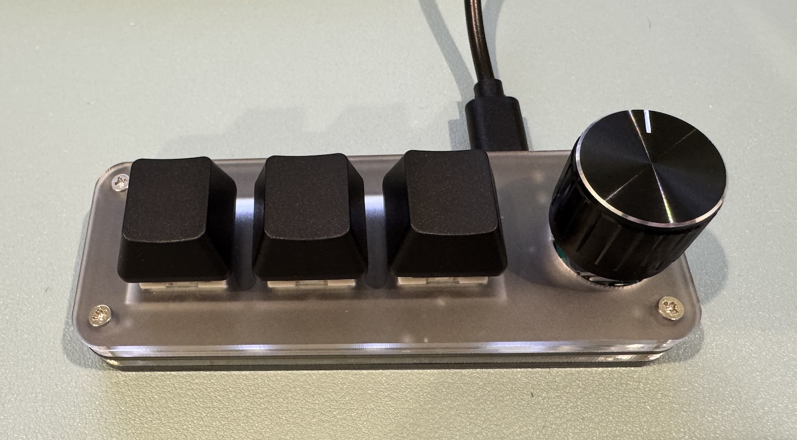
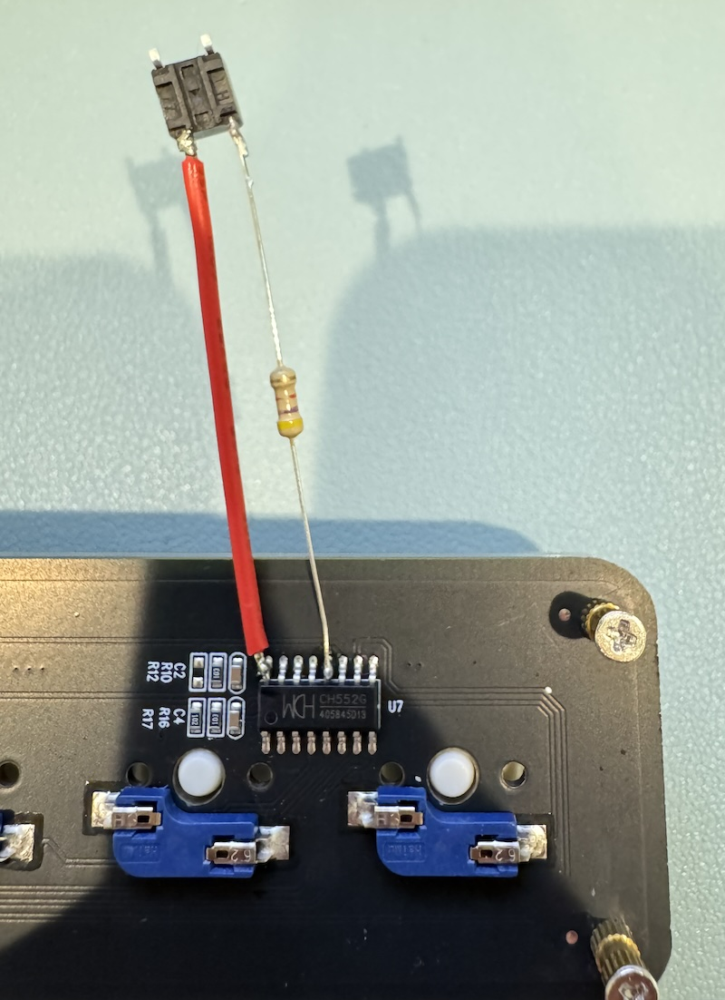
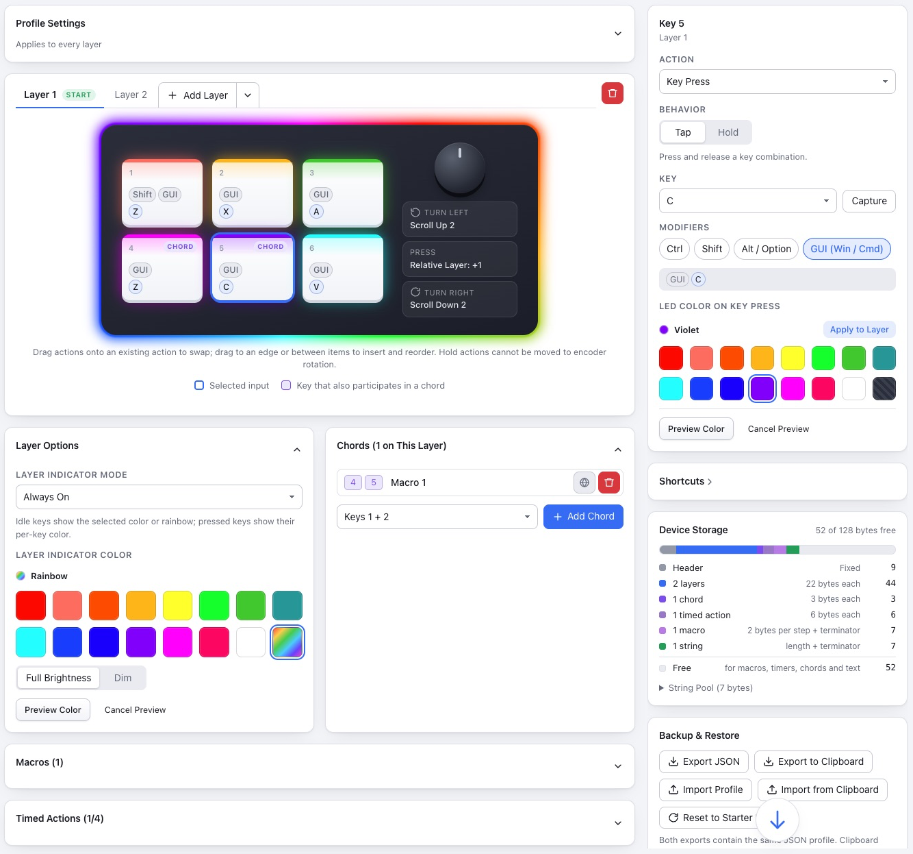

# CH552 Macropad v2

> [!NOTE]
> A Note on LLM Usage:
>
> This project was built with significant help from an LLM (`codex`).
>
> Any project of mine that uses help from an LLM will contain this message at the top of the README. If a project does not contain this message, it was fully written by me (a human)



_A three-key macropad of the type this project supports_

This project is an update to my original [CH552-macropad](https://github.com/perkinsb1024/CH552-macropad) project, a replacement firmware for generic wired USB macropads based on the [CH55xDuino library](https://github.com/DeqingSun/ch55xduino/).

Compared to the previous version, this project adds:

- A browser-based configurator, so you can update the device profile without editing or compiling the firmware
  - Drag and drop / copy and paste support
  - Importing and exporting of JSON profiles
  - Virtual device so you can play with configurations before setting up the hardware ([virtual 3-key](https://perkinsb1024.github.io/CH552-Macropad-v2/?sim=three) and [virtual 6-key](https://perkinsb1024.github.io/CH552-Macropad-v2/?sim=six))
- Read-only **Live View** for saved shortcuts, physical inputs, accepted bindings and runtime state
- Custom encoder wheel actions
- Layers
   - Including support for LED layer indicators (blink, 1.5 seconds, or always-on)
- **Chords** (multi-key inputs)
- **Timed Actions**, with optional inactivity reset and "wake input" blocking
- **Macros** for running multiple actions from a single trigger
- Both configuration and run-time **LED Control** options
- Mouse-move and click actions
- **Rainbow** RGB effects (come on, what good is a keyboard without them?)

Profiles are saved on the macropad; the configurator does not need to stay open during normal use.

[Open the Macropad Configurator in GitHub Pages](https://perkinsb1024.github.io/CH552-Macropad-v2/) (this only works once your macropad is running this project's firmware)

## Supported Macropads

The firmware supports three-key and six-key CH552 macropads with an encoder wheel. Select the correct variant before compiling. Four-key and wireless models are not supported by this build. Look for a wired macropad like the one pictured above and check that it uses a CH552 chip. Similar-looking models can use different hardware. Some boards do not have RGB LEDs fitted.

You can configure:

- Keyboard shortcuts, text, mouse actions and media controls
- The encoder button and both rotation directions
- Up to five layers on six-key pads or seven on three-key pads, plus two-key chords
- Key LED colors, layer indicators, and temporary bright or dim color/rainbow effects
- Up to five repeating or inactivity timers with optional next-input actions

Remarkably, due to having a smaller fixed-layer byte size (and therefore more possible layers), the 3-key macropad can assign almost as many distinct actions as the 6-key variant. With no timers and one global chord reserved for switching layers, the maximum remaining physical-input action slots for each model are:

| 3-Key Macropad | 6-Key Macropad |
| --- | --- |
| 45 | 47 |

*See the full calculations in [Action Capacity](documentation/Action%20Capacity.md)*

To use this configuration as a starting point, copy the contents of either the [3-key maximum action slot profile](profiles/3-key-max-action-slots.json) or [6-key maximum action slot profile](profiles/6-key-max-action-slots.json) and click **Import from Clipboard** in the [web configurator](https://perkinsb1024.github.io/CH552-Macropad-v2/).

## USB-C Cable Support

These macropads omit the necessary 5.1kΩ pull-down resistors to enable 5V output from USB-C to USB-C cables, so you will need to use a USB-A to USB-C cable or dongle for it to work. It *is* possible, however, to add these resistors yourself (notice I said "possible", not "easy"). If you want to enable true USB-C cable support, follow [this guide](documentation/USB-C%20Modification.md).

## Firmware Version History

Below are the primary firmware features added with each version

| Firmware Version | Primary Features Added |
| --- | --- |
| [v18](protocol/config-v18.md) | - Added one additional **Timed Action** slot (five total)  |
| [v17](protocol/config-v17.md) | - **Live View** shows physical inputs, triggers, sleep/timer countdowns, lighting and playback state<br> - Fixed a bug where forcing **Rainbow** through **LED Control** didn't respect runtime speed overrides |
| [v16](protocol/config-v16.md) | - Per-key idle colors (custom background palettes)<br> - **Rainbow** is available as a key-press color (**Teal** is no longer available)<br> - Runtime brightness overrides persist after waking from **Auto-Sleep** |
| [v15](protocol/config-v15.md) | - Optional **Auto-Sleep** after **15 Minutes**, **30 Minutes**, **1 Hour** or **2 Hours** of inactivity (can be enabled per-layer, can set LEDs to **dim** or **off**, and can optionally display layer indicator again on wake)  |
| [v14](protocol/config-v14.md) | - **Media / System with Modifiers** now supports **Hold**<br> - Added support for **Relative Layer While Held**<br> *This version also reorganized action types to keep logical groups together* |
| [v13](protocol/config-v13.md) | - Simultaneous X/Y mouse movement<br> - Modifier key support for 8-bit **Media / System** taps<br> - USB device names identify three-key and six-key macropads |
| [v12](protocol/config-v12.md) | - Added mouse buttons 4–8<br> - Persistent **Mouse Down** / **Mouse Up** actions for separate inputs and macro drags<br> - **Enter Bootloader** from the browser firmware installer<br> - Warning indication when USB enumeration fails |
| [v11](protocol/config-v11.md) | - Multi-step **Macros**, with support for **Pause** and repeat<br> - Added a 32ms pause between characters in **Type Text** actions |
| [v10](protocol/config-v10.md) | - **Timed Actions** can run globally or on a particular layer<br> - Interval resolution improved to 4.096 seconds<br> - Maximum **Timed Action** clock error reduced from 512ms to just 16ms<br> - **Note:** **Timed Actions** now consume 6 bytes each instead of 5 |
| [v9](protocol/config-v9.md) | - **Scroll** gains **Vertical / Horizontal** axis selection for taps and holds |
| [v8](protocol/config-v8.md) | - Maximum **Timed Action** error is improved from ~131s to 512ms<br> - **Media / System Hold** keeps a consumer control held until release (useful for brightness and volume)<br> - **Scroll** gains **Hold**, with 100ms between repeated step groups<br> - **Mouse Click** supports 1–16 clicks through **Single / Double / Custom**, replacing the separate **Mouse Double-Click** action. |
| [v7](protocol/config-v7.md) | - Up to four **Timed Actions**, repeating or restarted by input (aka: inactivity timers), with optional **On Next Input** actions and **Consume This Input**<br> - **Set All LEDs** adds temporary bright/dim colors or rainbow, always on or blinking 1–8 times<br> - **Previous Layer** becomes a target for persistent and one-shot layer switching. |
| [v6](protocol/config-v6.md) | - **LED Control** actions adjust brightness, **Rainbow Phase** and **Rainbow Speed** during use, with relative steps, common brightness presets, **Toggle Preset On/Off**, and configured restores<br> - **Variable — Scattered Colors** adds independently drifting rainbow colors. |
| [v5](protocol/config-v5.md) | - Configurable global **Rainbow Phase** (spacing) and **Rainbow Speed**, with four choices for each. |
| [v4](protocol/config-v4.md) | - More layers: up to five on six-key macropads or seven on three-key macropads.<br> - **Relative Layer** offsets expand to −6 through +6. |
| [v3](protocol/config-v3.md) | - **On for 1.5 Seconds** replaces **Blink Once** for **Layer Indicator**<br> - **Off** key colors can be transparent, letting the idle layer lighting show through<br> - **Rainbow** becomes available for timed and blinking layer indications. |
| [v2](protocol/config-v2.md) | - **Full Brightness** / **Dim** layer indicators<br> - Global chords<br> - Signed **Relative Layer** steps and one-shot layer switching<br> - Held pointer movement<br> - On-device color previews<br> *This was the first format with a published firmware release and archived configurator* |
| v1 (initial prototype) | - Browser configuration over WebHID, with profiles saved on the device<br> - Up to four layers<br> - Independent key, wheel-button and wheel-direction bindings<br> - Two-key chords<br> - Keyboard, mouse, media and **Type Text** actions<br> - Per-key colors and layer indications, including **Rainbow** lighting. |

## How to Compile the Firmware

> [!NOTE]
> Compiling the firmware is not necessary to install this project on your macropad.
>
> Pre-built v17 firmware files are available for [three-key](releases/ch552-macropad-3-key-64fa750c.hex) and [six-key](releases/ch552-macropad-6-key-64fa750c.hex) macropads, built from source revision `64fa750c`. This version adds **Live View** telemetry for physical inputs, accepted bindings, timers, lighting and playback state, and fixes runtime **Rainbow** speed overrides for **LED Control** effects. Hardware validation is complete. To use these files, skip compilation and follow [How To Upload the Firmware](#how-to-upload-the-firmware).

Current source targets v18 with up to five **Timed Actions**. Use the [active configurator](https://perkinsb1024.github.io/CH552-Macropad-v2/) for v18 source builds and the [frozen v17 configurator](https://perkinsb1024.github.io/CH552-Macropad-v2/versions/format-v17/) with these v17 release files. Published v16 firmware uses the [frozen v16 configurator](https://perkinsb1024.github.io/CH552-Macropad-v2/versions/format-v16/). [Previous versions](https://perkinsb1024.github.io/CH552-Macropad-v2/versions/) provide matching editors for older firmware. Back up your profile before updating firmware, then import it and click **Save to Device** in the matching editor to activate it. Updating firmware preserves DataFlash but leaves actions inactive until you save a profile in the matching editor. V18 migration retains existing actions and settings and converts global chord identifiers. Older **Teal** colors migrate to **Cyan** with brightness unchanged. Imports from before v15 start with **Auto-Sleep** disabled.

The current build and upload scripts target macOS. They use PlatformIO together with the compiler and upload tools installed by the CH55xDuino Arduino package.

A [beta browser firmware installer](webUploader/README.md) is also available for Chrome or Edge on Windows, macOS, and Linux. Its documentation includes USB driver and permission setup. Hardware flashing is confirmed working on MacOS.

### 1. Install the Tools

1. Install [PlatformIO IDE for VS Code](https://platformio.org/install/ide?install=vscode), or [PlatformIO Core](https://docs.platformio.org/en/latest/core/installation/index.html) if you prefer the command line
2. Install the [Arduino IDE](https://www.arduino.cc/en/software/)
3. In Arduino IDE's Settings/Preferences, add the following to **Additional Boards Manager URLs**:

   ```text
   https://raw.githubusercontent.com/DeqingSun/ch55xduino/ch55xduino/package_ch55xduino_mcs51_index.json
   ```

4. Open **Boards Manager**, search for **CH55xDuino**, and install version 0.0.25. The build expects this version and its bundled tools. See the [CH55xDuino installation instructions](https://github.com/DeqingSun/ch55xduino/#installation) for more help.

Arduino IDE supplies the board package; compile and upload this project using PlatformIO.

On macOS, the package is normally installed at `~/Library/Arduino15/packages/CH55xDuino`. If yours is elsewhere, set its location before building:

```sh
export CH55XDUINO_PACKAGE_DIR="/path/to/packages/CH55xDuino"
```

### 2. Download the Project

Clone the repository, then open its folder in PlatformIO:

```sh
git clone https://github.com/perkinsb1024/CH552-Macropad-v2.git
cd CH552-Macropad-v2
```

Run the firmware commands below from this folder. In PlatformIO IDE, its terminal provides the `pio` command.

### 3. Select Your Macropad

In [platformio.ini](platformio.ini), set `board_build.physical_variant` to match your hardware:

| Macropad | Setting |
| --- | --- |
| Six keys and encoder | `board_build.physical_variant = 0` (default) |
| Three keys and encoder | `board_build.physical_variant = 1` |

The other board settings are already configured for this firmware.

### 4. Compile

```sh
pio run -t clean
pio run
```

A successful build creates `.pio/build/ch552/firmware.hex`. Ordinary builds track firmware source and hardware-variant changes. The pre-build hook selects the repository's builder even if PlatformIO has an older cached copy of the local platform, preventing stale HEX files after source edits. A clean build is available when troubleshooting.

### Available Memory

Memory in the current v18 source at revision `fa1e88a`, in bytes, with a 14,336-byte application flash limit:

| Resource | 3-Key | 6-Key |
| --- | ---: | ---: |
| Flash Used | 14,201 | 14,205 |
| Flash Remaining | 135 | 131 |
| Total External RAM Allocated | 785 | 794 |
| Stack Available (Linker Reserve) | 105 | 102 |

### Build Release HEX Files for Both Variants

For the documentation, history, archives and validation steps, follow the [firmware release process](documentation/Firmware%20Release%20Process.md).

The [releases](releases/) folder contains compiled firmware for three-key and six-key macropads. To refresh both files, run this from the project root:

```sh
pio run -t releases
```

This rebuilds both variants in separate build folders, without changing your selected variant in `platformio.ini` or uploading anything to hardware. It exports both files only after both builds succeed.

Filenames include the key count and the current commit's unique short Git hash, for example `ch552-macropad-3-key-a1b2c3d4.hex`. Git uses at least eight characters and extends the hash if needed to distinguish it from other objects in the local repository.

The `dirty` marker only counts uncommitted changes to the main firmware sketch, `platformio.ini`, C source and header files under `src/`, and C, header, Python and JSON files under `pio-platform/`. This includes staged changes, deletions and new files. Other changes, including documentation, images, the web app, tests, release binaries and Python caches, do not count.

When those firmware or PlatformIO files have changes, the name includes `dirty` before the hash, such as `ch552-macropad-6-key-dirty-a1b2c3d4.hex`. Commit those changes before generating files that should match a specific revision.

After both builds and exports succeed, older generated HEX files are deleted so `releases/` keeps only the latest three-key and six-key pair. If a build fails, the previous release files are kept.

## How to Upload the Firmware

The hardest part of this project is getting the board into the bootloader (firmware update mode) the first time. Once you do that, everything else is easy. A macropad with its factory firmware requires a hardware bootloader entry for the first upload. Once this firmware is installed, you can enter the bootloader again by holding the encoder button while powering on the macropad.

### First Upload: Enter the Bootloader via Hardware

> [!NOTE]
> If you don't want to unscrew your macropad and carefully poke it with tweezers, I *have* been working on an alternate method, using a small Raspberry PI PR2350-based board. This method is somewhat finicky, but it does work, and doesn't require you to open your macropad and poke it. Check out [this guide](tools/rp2350-programmer-release/README.md) for more information.

The following instructions and photo apply to the CH552G board shown in the original project. Confirm your chip's pin numbering and board layout before connecting anything.

1. Unplug the macropad from USB
2. Remove the bottom screws and acrylic plates to expose the CH552G chip
3. Locate USB D+ (pin 12) and 3.3 V (pin 16). On the pictured board, with the USB-C port toward the top, these are the fifth pin from the left and the leftmost pin on the top row, respectively.
4. Prepare a temporary connection between these pins. You can solder in a simple button (as shown in the photo below), or a pair of small jumper wires. You can also (carefully) bridge the pins with a pair of fine-tipped metal tweezers.
5. Start the upload command:

   ```sh
   pio run -t upload
   ```

6. When the uploader says it is waiting for the bootloader, connect D+ to 3.3 V while the macropad is unplugged, plug it into USB, then release the connection. Do this within the uploader's ten-second waiting period.
7. Wait for the upload to finish. If it times out, unplug the macropad and repeat the upload and bootloader-entry steps.
8. Unplug the macropad before removing any temporary wiring or reassembling it, then reconnect it for configuration



_An example of using a temporary button to enter the bootloader before uploading firmware_

> [!CAUTION]
> Warning: Avoid bridging adjacent pins, especially ground (pin 14). Shorting a supply to ground can damage the board or USB port

### Later Uploads: Enter the Bootloader

By default, **Upload** (`pio run -t upload`) waits for browser or manual
bootloader entry and does not use the native HID helper. With v12 or later
firmware, click **Enter Bootloader** in the [browser firmware installer](webUploader/)
before starting **Upload**, or hold the encoder button while reconnecting USB
when the uploader starts waiting.

The optional native HID helper may require macOS **Input Monitoring** permission
for VS Code or the terminal. The helper uses shared access on macOS because
exclusive access to the keyboard interface can be rejected even with that
permission enabled. Open failures include the native macOS error details.
Browser or encoder entry avoids using this helper.

To use the helper, install its dependency once from the project folder using
PlatformIO's Python interpreter:

```sh
~/.platformio/penv/bin/python -m pip install --target .pio/hidapi -r pio-platform/requirements-hid.txt
```

The **Enter Bootloader (Optional HID)** task (`pio run -t bootloader`) requests
entry without building or uploading firmware. To also enable native HID entry
before **Upload**, set `custom_hid_bootloader = yes` in `platformio.ini`;
the default is `no`. Close any configurator or installer connection first,
and connect only the macropad you want to update. Reinstall the helper if you
delete `.pio/`.

Bootloader entry methods:

- At power-up: Unplug the macropad, hold the encoder button, and reconnect USB. This method is always available, even if no valid profile is saved.
- During use with v12 or later firmware: Click **Enter Bootloader** in the [browser firmware installer](webUploader/). Select the running macropad, then click **Connect Bootloader** to upload firmware. Runtime encoder holds do not enter bootloader mode.

Firmware checks that the encoder stays pressed across a 10ms startup
window, sampling every 1ms. Hold it steadily before connecting USB.

Older v11 firmware supports an optional three-second encoder hold on enabled
layers. For an invalid profile on v11, use the power-up method.

If the device cannot run the firmware, use the hardware method above to recover it.

## Configuring Your Macropad

For a complete guide to actions, layers, chords, timed reminders, lighting, and the editor's shortcuts, see the [Configuration Overview](documentation/Configuration%20Overview.md).

### Use the Hosted Web App



_The Configurator Web App_

No local web app installation is needed. Open the [Macropad Configurator](https://perkinsb1024.github.io/CH552-Macropad-v2/) in desktop Chrome, Edge, or another browser with WebHID support.

1. Plug the macropad into the computer running the browser. It must be running this firmware, rather than sitting in bootloader mode.
2. Click **Connect Macropad** and select **3-Key Macropad** or **6-Key Macropad** in the browser's device chooser (older firmware appears as **Universal Macropad**)
3. Set up the keys, encoder, layers, chords, macros, timed actions and LED effects. If no valid profile is saved, the editor loads a starter profile for you to customize.
4. Click **Save to Device** and wait for the saved confirmation. Changes in the editor take effect on the hardware only after saving.
5. Close the browser and use the macropad normally. Its saved profile survives unplugging it.

On first use, or when the saved profile is invalid, key and encoder actions stay inactive and one red LED blinks until you save a valid profile. The USB configurator connection still works. v12 also accepts **Enter Bootloader** from the firmware installer in this state.

**Scroll** offers **Vertical / Horizontal** axis selection, with **Up / Down** or **Left / Right** direction controls. Both axes support taps and held repeats with the same 100ms interval. Horizontal scrolling requires v9 firmware.

**Macros** tie an ordered sequence to a key, encoder direction, chord or timer. Add a macro and its steps, then assign **Execute Macro**, choose the macro and set **Repeat Count** from 1–16. **Pause** waits 0–4080ms in 16ms increments; consecutive pauses allow longer waits. For example: **Key Tap** GUI+Space → **Pause** 256ms → **Type Text** `chrome` → **Key Tap** Enter. Application timing depends on the host, so adjust pauses as needed.

**Type Text** waits 32ms after each character's key release before continuing, including after tabs, newlines and the final character. This gives applications time to process the input; commands may still need an explicit **Pause** before Enter.

Definitions allocate storage only when present: two bytes per step plus a one-byte terminator (the last sequence can use the image boundary). Repeats cost no extra configuration bytes. Strings share the normal pool. Held actions and nested macros are unavailable. Layer switches must be the final step, and macros containing them must have **Repeat Count** set to 1. Playback streams steps through one active macro instead of filling the eight-event queue; later queued actions wait, and new invocations are dropped if that queue fills. Immediate actions may interleave, and an effective layer change cancels playback.

Configuration format 18 supports five six-key layers or seven three-key layers in a 128-byte profile. Up to five **Timed Actions** repeat any action that does not require a release, globally or on one selected layer. Intervals use 1–2048 ticks of 4.096 seconds, up to 2 hours 19 minutes 48.608 seconds. Timers can restart on input, run an optional action on the next input, and consume that input. An effective layer change resets layer-specific intervals while preserving armed **On Next Input** actions; global intervals continue. Each timer has its own phase, with less than 16ms early clock quantization and possible additional playback/USB delay. Each timer uses six configuration bytes.

**Auto-Sleep** in **Layer Options** enables LED inactivity sleep per layer without extra storage or a timer slot. **Profile Settings** provides **Sleep Timeout** choices of **15 Minutes**, **30 Minutes**, **1 Hour** and **2 Hours**, plus **Consume Wake Input**, **Show Layer Indicator** and **Dim Instead of Off**. Defaults preserve a 30-minute timeout, LEDs off during sleep, a consumed wake input and the current layer reminder. Disable **Consume Wake Input** to wake and execute the first binding. Dimming uses the existing fixed brightness for layer indicators and pressed-key feedback. Physical presses and completed encoder turns restart the interval. Switching between enabled layers preserves elapsed time. Entering a disabled layer clears the timer and restores awake lighting if asleep, even when a timed action changes layers; returning to an enabled layer starts a full timeout. Format 16 firmware restores the indicator and key-press brightness policies selected before sleep, including manual overrides. Timed or macro LED commands do not end sleep or replace that selection. Published v15 firmware restores **Both as Configured**. The active editor targets v18; the bundled v17 firmware uses its frozen editor.

As of firmware v16, **LED Control** brightness overrides persist after waking from auto-sleep. For example, selecting **Layers and Keys Dim** before sleep restores that same dim setting on wake, even when sleep turns the LEDs off. Indicator and key-press overrides are remembered independently.

**Media / System** set to **Hold** holds a consumer control until release. Host/application
support determines whether it repeats. The newest media action wins; previous
holds are not restored. Keyboard and consumer holds continue across layer changes
until their physical input releases. **Scroll** offers **Tap/Hold** on keys, chords and
the wheel button; rotation and timers remain single steps. Release stops new
scroll repeats while already accepted steps finish. Held scrolling waits at
least 100ms after each complete step, giving about ten steps per second at
step 1; pointer holds retain their 8ms interval.

V12 supports **Left**, **Right**, **Middle** and **Button 4** through **Button 8**.
Extra-button behavior depends on the host and application, especially buttons 6–8.
**Mouse Down** and **Mouse Up** set and clear selected bits of the same global
persistent state used by **Mouse Toggle**. Repeated down/up is idempotent; macro
completion leaves the state intact, while layer changes and resets clear it.
Physical **Mouse Hold** and temporary clicks remain independent. Use **Mouse Down**
→ **Move Pointer X**, **Move Pointer Y**, or **Move Pointer X/Y** → **Mouse Up** for a macro drag.

**Mouse Click** offers **Single / Double / Custom**. **Custom** shows a slider for
3–16 clicks. The selected mouse buttons are pressed and released for each click,
with a 200ms pause between clicks. **Custom** remembers its last count per action
slot when switching modes and shows an estimated duration rounded to one decimal.
The sequence delays subsequent queued actions; holds, media and layer/LED actions
use independent handling. Legacy double-click bindings (v7 and earlier) migrate to
**Mouse Click** with a count of two.

**LED Control** includes brightness presets, rainbow speed/phase, and **Set All LEDs** for a temporary bright or dim color or rainbow, always on or blinking 1–8 times. Always-on effects persist until restored, replaced, or a layer change. Clearing or completing an effect restores normal lighting without replaying the layer's blink/timed indication. Saved layer settings remain independent.

At power-up with a valid profile, LEDs stay dark while waiting for USB enumeration.
If enumeration has not completed after one second, **Key 1** starts blinking yellow.
Successful enumeration or pressing **Key 1** clears the warning and starts normal
operation with the configured
layer indication. The dismissal press does not run its assigned action; release
the key before pressing it again. Manual dismissal allows local operation, while
keyboard and mouse output still require USB enumeration. The warning is startup
only; later USB resets do not restart it. An invalid profile takes priority and
shows the existing blinking red error LED instead.

**Relative Both Brightnesses** starts from the brighter current indicator/key brightness, applies the signed step once through **Off** → **Dim** → **Bright** → **Off**, and sets both to the result. Configured policies resolve to the current layer's saved indicator brightness and **Bright** key feedback first. Earlier firmware stepped each brightness independently; synchronized stepping requires updated firmware, with no profile conversion.

**Switch to Layer** and its one-shot variant include **Previous Layer**, encoded as target `0xFF`. Persistent selections remember the base layer being left; repeating **Previous Layer** swaps between the current and remembered layers. Momentary and one-shot visits do not replace that history. The one-shot **Previous Layer** option visits the remembered layer for one action, then returns. **Timed Actions** can use either variant.

The editor can import older profiles while preserving bindings and metadata. Back up your profile before updating firmware, then import it and click **Save to Device** to apply it. See [configuration format 18](protocol/config-v18.md) for the active editor's complete format reference. Older **Teal** colors migrate to **Cyan** with brightness unchanged.

Use **Export JSON** and **Import Profile** in **Backup & Restore** to back up and share profiles. Importing loads a profile into the editor; click **Save to Device** to apply it to the macropad.

You can also **Edit Offline** or try a simulated macropad from the welcome screen. Browsers without WebHID, including Safari and Firefox, can edit and export profiles but cannot save them directly to hardware.

### Live View

Open **Live View** from the configurator's top bar, then connect the macropad in
that tab to follow its saved shortcuts and active layer. The view includes chords,
macros and timed actions. **Follow Device** returns to the active layer after
browsing another layer.

With v17 or v18 firmware, blue outlines show physical presses
and encoder turns; green flashes show accepted bindings. **Live Activity** shows
the latest binding, sleep countdown, runtime lighting, layer state and playback
queue. Timer summaries show remaining time and armed next-input actions.
A consumed wake input can show physical activity without running its binding.
Accepted bindings can still be waiting for output; the view is not a complete
event history or confirmation that an application received the action.

The frozen v16 viewer retains the saved-profile/layer view without live telemetry.
The active viewer targets v18 and supports all five user timers. The bundled v17
release uses the frozen v17 viewer and includes the telemetry extension. See the
[Live View guide](documentation/Configuration%20Overview.md#live-view) for details.

### Run the Web App Locally

For development or local use, install [Node.js](https://nodejs.org/) (Node 22 recommended), then run:

```sh
cd webapp
npm ci
npm run dev
```

Open the localhost URL printed in the terminal, normally http://localhost:5173. Keep the terminal running while using the app; press **Ctrl+C** to stop it.

To open the editor on another device on the same Wi-Fi, start it with:

```sh
npm run dev -- --host 0.0.0.0
```

Open the printed network URL on the other device. Plain HTTP over the network supports editing and exporting profiles, but hardware access requires HTTPS or localhost. The hosted GitHub Pages app provides HTTPS without local certificate setup. In all cases, USB access is to the macropad plugged into the computer running the browser.

To build the static site locally:

```sh
npm run build
npm run preview
```

The production files are written to `webapp/dist/`. Before publishing changes,
run `npm run verify:deploy` from `webapp/` to test the configurator and freshly
built uploader, then build the complete site and verify frozen archives. This
repository's [GitHub Actions workflow](.github/workflows/deploy-pages.yml) runs
that same gate on every pull request to `main`. It publishes the configurator,
uploader and frozen archives after deployment inputs are pushed to `main`,
including the root README's release notes. Follow the
[release process](documentation/Firmware%20Release%20Process.md) for firmware
checks and optional repository protection. The active editor lives at the
site's root; [archived editors](https://perkinsb1024.github.io/CH552-Macropad-v2/versions/)
live under `versions/`. No separate Pages site or tag deployment is needed.

## Troubleshooting

- Missing CH55xDuino component: Install board package version 0.0.25 and check `CH55XDUINO_PACKAGE_DIR` if you use a custom location
- Upload cannot find the device: Use a USB-A to USB-C cable with data pins (this cheap board omits the necessary 5.1k pulldown resistors for USB-C cables to supply power), wait for the upload prompt, and enter the bootloader within ten seconds. Factory firmware generally needs the hardware method.
- Macropad does not appear in the browser: Use a supported desktop browser, HTTPS or localhost, and this firmware. Reconnect USB after uploading.
- **Key 1** blinks yellow after a one-second startup delay: USB enumeration has not completed. Check the USB data cable and connection, or wait for the computer to finish recognizing the device. Enumeration clears the warning automatically. Press **Key 1** to dismiss it manually; that press does not run its assigned action, and keyboard/mouse output still requires USB enumeration.
- One red LED blinks and inputs do nothing: Connect the configurator and save a valid profile
- The wrong keys respond: Check the physical variant in `platformio.ini`, clean the build, and upload again

For Linux WebHID permissions, see the [web app README](webapp/README.md#linux-device-access). The firmware build and upload scripts currently target macOS.

## Further Documentation

- [Web app development and usage](webapp/README.md)
- [Current Configuration Format](protocol/config-v18.md)
- [Published v16 Configuration Format](protocol/config-v16.md)
- [USB configuration protocol](protocol/hid-v1.md)
